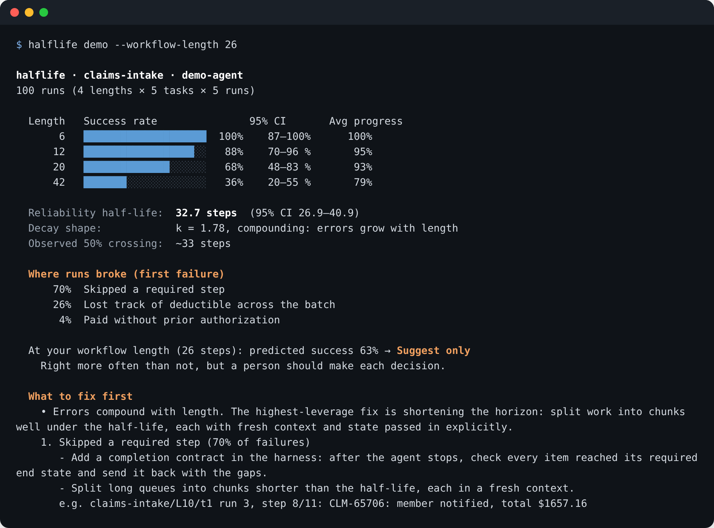
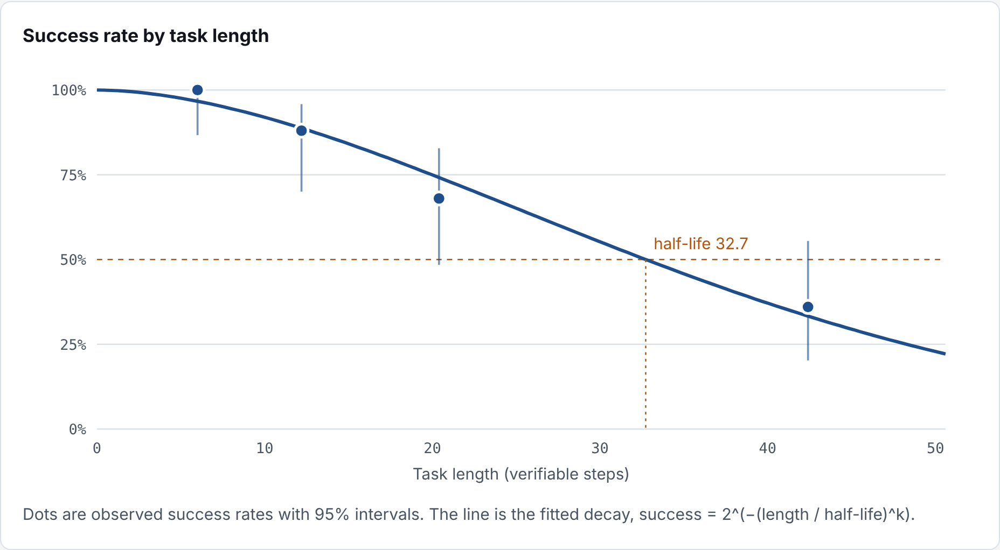

# halflife

**Your agent works on 5-step tasks. Does it work on 50?**

[](https://github.com/ev-prawda92/halflife/actions/workflows/tests.yml)
[](https://pypi.org/project/halflife-ai/)
[](pyproject.toml)
[](LICENSE)

halflife measures your agent's **reliability half-life**: the task length at which it succeeds half the time. Then it tells you where runs broke, what to change, and re-runs exactly the cases that failed once you've changed it.

Agents fail quietly as tasks get longer: they lose a running total from step 4 by step 30, skip the last item, pay a duplicate they saw twenty steps ago. Unit tests and single-turn evals don't catch it. halflife does, in your terminal, your tests, your CI, and your coding agent.

<p align="center"></p>

> The numbers above come from `halflife demo`, a simulated agent built to show the tool. Run it on your own agent for real numbers.

## Start in one minute

```
pip install halflife-ai
halflife demo
```

Then pick the way in that fits what you have.

### You have agent logs → audit them

No setup, any framework, any model. Point it at your logs (JSON Lines of tool calls) and write down what must always be true:

```python
from halflife.rules import at_most_once, covers, eventually, requires

RULES = [
    covers("list_claims", field="claims", actions=["finalize_claim", "flag_for_review"], key="claim_id"),
    requires("finalize_claim", before="get_claim", match=["claim_id"]),
    eventually("finalize_claim", then="notify_member", match=["claim_id"]),
    at_most_once("notify_member", key=["claim_id"]),
]
```

```
halflife audit agent_logs.jsonl --rules rules.py
```

You get the half-life measured in tool calls, which rules break and how often, and where. No answer key needed. Try it on the sample: `halflife audit examples/traces/claims.jsonl --rules examples/rules_claims.py`.

### You have agent code → benchmark it

```python
from halflife import benchmark

@benchmark(suite="claims-intake")
def my_agent(task):
    return agent.run(task)
```

```
halflife run my_agent.py --quick
```

Your agent runs against a realistic simulated system with a hidden answer key, on tasks from 5 to 40 steps, several times each. Or scaffold everything with `halflife init`.

### You want to compare models → bench them

```
halflife bench --model ollama:qwen2.5:7b --model anthropic:claude-sonnet-5-5 --quick
```

Built-in agents for Ollama, LM Studio, vLLM, OpenAI, OpenRouter, Together, Groq, Anthropic, and any OpenAI-compatible server. No code.

### You use Claude Code or Cursor → let your coding agent fix your agent

```
claude mcp add halflife -- halflife mcp
```

Your coding agent can now run the benchmark, read what broke and how to fix it, change your code, and replay exactly the failing cases until it holds up. A Claude skill is in [`integrations/`](integrations/).

## Every run tells you what to do next

<p align="center"></p>

- **Half-life with a 95% interval.** Only lengths you actually tested count: if you tested up to 20 steps, it says "≥ 20", never a made-up number.
- **Decay shape.** Do errors compound as tasks grow, or happen early? The fix differs.
- **Where runs broke.** The first failure in each run, grouped: lost track of state, skipped a step, acted without a check, looped, broke a rule.
- **What to fix first.** Ranked changes, structural fixes before prompt tweaks, each with a failing run as evidence.
- **Should it act on its own?** `--workflow-length 26` predicts success at your real workflow length and recommends act autonomously, act with approval, suggest only, or shadow mode.
- **Change since last run.** Every run compares itself with the previous one: `half-life 32.7 → 28.1 steps (−14%, worse)`.
- **An eval pack.** The exact failing tasks, saved. After a fix: `halflife run my_agent.py --replay .halflife/<run>.evals.json`.
- **An HTML report** to share, and JSON for your pipeline.

## Make it a habit

In your tests:

```python
import halflife

def test_agent_is_reliable():
    halflife.assert_reliable(my_agent, min_half_life=15)
```

In CI (`halflife init --ci` writes the workflow):

```
halflife run my_agent.py --min-half-life 20
```

In your README: `halflife badge` writes 

## Plug in any agent

Your function gets a `task`:

| | |
|---|---|
| `task.instructions` | the goal and the policy |
| `task.call(name, args)` | run a tool; errors come back as `{"error": ...}` so your agent can recover |
| `task.openai_tools()` | tool definitions for OpenAI-compatible APIs (Ollama, vLLM, OpenRouter…) |
| `task.anthropic_tools()` | tool definitions for the Anthropic API |
| `task.max_tool_calls` | the budget; going over ends the run, which catches loops |

Full examples: [`examples/claude_agent.py`](examples/claude_agent.py), [`examples/openai_agent.py`](examples/openai_agent.py).

<details>
<summary><strong>Providers for <code>halflife bench</code></strong></summary>

| Provider | Key | Notes |
|---|---|---|
| `ollama` | none | local; set `OLLAMA_HOST` if not localhost |
| `lmstudio`, `vllm` | none | local; `--base-url` if not the default port |
| `compatible` | `HALFLIFE_API_KEY` (optional) | any OpenAI-compatible server, with `--base-url` |
| `openai` | `OPENAI_API_KEY` | |
| `openrouter` | `OPENROUTER_API_KEY` | one key for most open and closed models |
| `together`, `groq` | `TOGETHER_API_KEY`, `GROQ_API_KEY` | |
| `anthropic` | `ANTHROPIC_API_KEY` | prompt caching on by default |

**Ollama:** start it with a large context window, or long tasks fail for the wrong reason, because the default window silently drops older messages:

```
OLLAMA_CONTEXT_LENGTH=32768 ollama serve
```

</details>

## Rules

Invariants checked on every run's tool calls. They need no answer key, so they work on any agent and on production logs.

| Rule | Fails when |
|---|---|
| `requires(A, before=B, match=[...])` | A happens without an earlier matching B |
| `at_most_once(A, key=[...])` | A happens twice for the same key |
| `eventually(A, then=B, match=[...])` | A is never followed by a matching B |
| `covers(S, field, actions, key)` | an item listed by S never reaches one of the actions |
| `never(A, when=...)` | A happens with forbidden arguments |
| `no_loops(n)` | the same call repeats more than n times in a row |
| `recovers_from_errors()` | the agent resends a call that just failed |
| `@rule` | anything you can write as a function of the steps |

Use them in audits, or add them to benchmarks: `halflife run my_agent.py --rules rules.py`.

## Built-in suites

| Suite | Domain | What gets harder with length |
|---|---|---|
| `claims-intake` | Health plan claims: eligibility, network, coverage, prior auth, deductibles | Members recur across claims; the deductible shown is from the start of the batch, so state must be carried |
| `invoice-matching` | Accounts payable: blocked vendors, duplicates, price and quantity checks | Duplicates repeat earlier invoices; receipts are consumed by earlier approvals |

Every suite ships with a test proving that an agent following the written policy exactly scores 100%, so a failure is the agent's, not the answer key's. Write your own suite in about 40 lines: [`examples/custom_suite.py`](examples/custom_suite.py). `halflife show --suite claims-intake --length 10 --answers` prints exactly what an agent sees, plus the answer key.

## How the number works

Success at length L is modeled as `2^(−(L/h)^k)`. h (half-life) and k (decay shape) are fit by maximum likelihood over every run, with a bootstrap 95% interval. The observed 50% crossing is reported alongside as a model-free check. Full definitions, file formats, and reporting rules are in [SPEC.md](SPEC.md), so any tool can produce comparable numbers.

**Related work.** Measuring capability by the length of task completed half the time builds on METR's time-horizon research on frontier models. halflife applies the idea to your own agent on your own workflows, explains why runs fail, and makes it a daily development check.

## Commands

```
halflife run FILE[:function] [--quick] [--suite S] [--lengths 5,10,20,40] [--tasks N] [--runs N] [--rules FILE] [--workflow-length W] [--min-half-life H] [--replay PACK] [--save-traces FILE] [--workers N] [--out DIR]
halflife bench --model PROVIDER:MODEL [--model ...] [same options]
halflife audit TRACES.jsonl [--rules FILE] [--workflow-length W] [--min-half-life H]
halflife init [--suite S] [--ci]
halflife badge [RESULT.json]
halflife compare RESULT.json [RESULT.json ...]
halflife show [--suite S] [--length N] [--answers] [--json]
halflife mcp
halflife demo [--suite S] [--quick]
halflife suites
```

## Roadmap

- Generate test environments automatically from an MCP server or OpenAPI spec, so any agent gets a benchmark with no hand-written suite
- Read OpenTelemetry GenAI traces directly in `halflife audit`
- Adapters for popular agent frameworks
- TypeScript SDK
- More suites: support, IT ops, procurement, coding

Ideas and suites welcome: see [CONTRIBUTING.md](CONTRIBUTING.md).

## License

Apache 2.0
